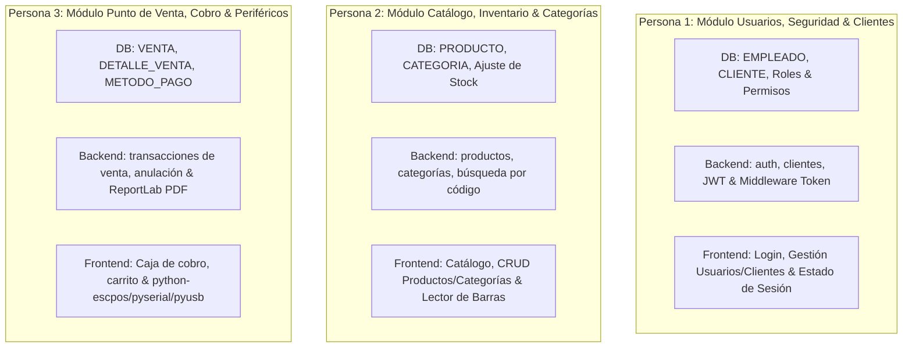

# Guía de Organización y Plan de Desarrollo: Punto de Venta (POS)

Este documento define la estrategia, arquitectura, asignación equitativa de módulos y flujo de trabajo para el desarrollo colaborativo del sistema de Punto de Venta de escritorio entre los **3 integrantes** del equipo.

---

## 1. Análisis del Proyecto y Estado Actual

### 1.1 Comparación con la estructura inicial
En la revisión previa, las carpetas de base de datos (`db/schema/`, `db/migration/`, `db/backup/`) solo contenían esqueletos y archivos `README.md` vacíos. Recientemente se han incorporado 3 scripts SQL fundamentales:
1. **`db/schema/01_tablas_iniciales.sql`**: Define el esquema relacional DDL (PostgreSQL) con 7 entidades base:
   - `CATEGORIA`
   - `METODO_PAGO`
   - `CLIENTE`
   - `EMPLEADO` (roles: Cajero, Administrador, Supervisor; hashes bcrypt)
   - `PRODUCTO` (stock con precisión decimal `NUMERIC(10,3)`, precios, código de barras)
   - `VENTA` (cabecera con estados 'Completada', 'Cancelada')
   - `DETALLE_VENTA` (relación N:M de artículos vendidos, subtotales, cascada de borrado)
2. **`db/migration/02_datos_iniciales_sistema.sql`**: Carga datos maestros necesarios para el arranque operativo:
   - Métodos de pago oficiales ('Efectivo', 'Tarjeta Débito', 'Tarjeta Crédito', 'Transferencia').
   - Categoría por defecto ('General').
   - Usuario Administrador principal (`admin@pos.com`).
3. **`db/backup/03_seed_datos_prueba.sql`**: Datos semilla de desarrollo y pruebas:
   - Empleados adicionales (Cajero y Supervisor).
   - Categorías adicionales (Bebidas, Snacks, Farmacia, Abarrotes).
   - Clientes registrados y ventas de prueba con detalles.
   - Sincronización explícita de secuencias `SERIAL` (`setval`) para compatibilidad directa con inserciones desde FastAPI.

### 1.2 Infraestructura de Base de Datos Compartida
- **Motor**: PostgreSQL 15+ alojado en **Supabase**.
- **Ventaja**: Al estar en una organización compartida de Supabase, los 3 integrantes consultan y modifican la misma base de datos en tiempo real mediante cadena de conexión remota (`DATABASE_URL`), eliminando discrepancias de entornos locales.

---

## 2. Stack Tecnológico Oficial y Dependencias Faltantes

Para garantizar que el sistema funcione uniformemente y respete la restricción de tecnologías acordadas:

### 2.1 Backend (Python 3.10+)
- **API & Servidor**: `FastAPI`, `uvicorn`.
- **Validación y Modelos**: `pydantic`.
- **Persistencia & ORM Asíncrono**: `SQLAlchemy` (v2.0+) + `asyncpg` (driver asíncrono para PostgreSQL/Supabase). *(⚠️ Pendientes de agregar a `backend/requirements.txt`)*.
- **Seguridad y Criptografía**: `passlib` (con motor `bcrypt`), `pyjwt` (manejo de tokens JWT).
- **Reportes & Formato**: `reportlab` (generación de tickets/facturas PDF), `textwrap` (módulo nativo estándar para saltos y formateo de texto en tickets).

### 2.2 Frontend (Python 3.10+ Desktop)
- **Interfaz Gráfica**: `Flet` (aplicación de escritorio moderna y reactiva basada en Flutter).
- **Consumo de API**: `httpx` (cliente HTTP asíncrono).
- **Modelos locales**: `pydantic` (tipado de respuestas y estados).
- **Hardware POS (Periféricos)**:
  - `python-escpos`: Control de impresoras térmicas de tickets.
  - `pyserial`: Comunicación serial (balanzas, lectores seriales, impresoras COM).
  - `pyusb`: Comunicación directa por puerto USB para impresoras y periféricos. *(⚠️ Pendiente de agregar a `frontend/requirements.txt`)*.

---

## 3. Asignación Modular y Distribución Equitativa (3 Integrantes)

Para que los **3 desarrolladores aprendan y dominen tanto Backend, Frontend como Base de Datos**, el proyecto se distribuye en **3 módulos de dominio equilibrados**. Cada persona es dueña de su módulo de punta a punta (Full-Stack vertical: DB/SQLAlchemy -> API FastAPI -> UI Flet + Consumo HTTP).



---

### 👤 Persona 1: Módulo de Seguridad, Autenticación y Clientes

**Objetivo:** Control de acceso al sistema, sesiones de usuario, roles y libreta de clientes.

#### 1. Base de Datos & ORM (`backend/src/core/` y `modules/auth/`)
- Mapear modelos SQLAlchemy para las tablas `EMPLEADO` y `CLIENTE`.
- Implementar hashing seguro de contraseñas con `passlib` (bcrypt).
- Configurar generación y verificación de JWT (`pyjwt`).
- Completar `backend/src/core/middlewares/token.py` para proteger endpoints según rol (`Administrador`, `Supervisor`, `Cajero`).

#### 2. Backend (FastAPI en `backend/src/modules/auth/` y `backend/src/modules/clients/`)
- Endpoints de autenticación:
  - `POST /api/auth/login`: Validación de credenciales y retorno de token JWT + datos de empleado.
  - `GET /api/auth/me`: Retorna la información del usuario autenticado.
- Endpoints de gestión de empleados (solo accesibles por Administrador):
  - CRUD completo de empleados (`GET /api/employees`, `POST`, `PUT`, `DELETE`).
- Endpoints de gestión de clientes:
  - CRUD de clientes (`GET /api/clients`, `POST`, `PUT`, `DELETE`) y búsqueda por nombre/RFC.

#### 3. Frontend (Flet en `frontend/src/`)
- **Vistas (`views/`)**:
  - `login_view.py`: Pantalla de inicio de sesión con validaciones visuales.
  - `users_view.py`: Panel de administración de empleados (para rol Admin).
  - `clients_view.py`: Directorio y registro de clientes habituales / facturación.
- **Servicios (`services/`)**:
  - `auth_service.py`: Peticiones HTTP (`httpx`) a login y almacenamiento seguro en memoria/sesión del token.
  - `client_service.py`: Peticiones HTTP para consultar y crear clientes.
- **Componentes (`components/`)**:
  - Diálogos modales para agregar/editar clientes y empleados.

---

### 👤 Persona 2: Módulo de Catálogo, Productos e Inventario

**Objetivo:** Administración integral de existencias, control de inventarios, categorías y códigos de barras.

#### 1. Base de Datos & ORM (`backend/src/modules/product/`)
- Mapear modelos SQLAlchemy para `PRODUCTO` y `CATEGORIA`.
- Diseñar consultas asíncronas para control de stock mínimo y alertas de desabasto.
- Validar unicidad de `codigo_barras` y reglas de integridad de precios/costos.

#### 2. Backend (FastAPI en `backend/src/modules/product/` y `categories/`)
- Implementar los archivos ya estructurados en `backend/src/modules/product/`:
  - `product.model.py`: Modelo SQLAlchemy de `PRODUCTO` y `CATEGORIA`.
  - `produc.schema.py` (o `product.schema.py`): Esquemas Pydantic (`ProductCreate`, `ProductUpdate`, `ProductResponse`).
  - `product.controller.py`: Lógica de negocio (actualización de stock, filtrado por categoría, cálculo de márgenes de ganancia).
  - `product.route.py`: Endpoints REST:
    - `GET /api/products`: Lista paginada con filtros por nombre o categoría.
    - `GET /api/products/barcode/{code}`: Búsqueda rápida por lector óptico para la caja.
    - `POST /api/products`, `PUT /api/products/{id}`, `DELETE /api/products/{id}`.
    - `GET /api/products/low-stock`: Alerta de productos con stock actual menor o igual a stock mínimo.
    - CRUD complementario para categorías (`GET /api/categories`, `POST`).

#### 3. Frontend (Flet en `frontend/src/`)
- **Vistas (`views/`)**:
  - `products_view.py`: Tabla interactiva con búsqueda en tiempo real, filtro por categorías y paginación.
  - `inventory_adjust_view.py`: Vista rápida para entrada y ajuste manual de mercancía.
  - `categories_view.py`: Gestión simple de categorías.
- **Servicios (`services/`)**:
  - `product_service.py`: Consumo con `httpx` de todos los endpoints de productos y categorías.
- **Componentes (`components/`)**:
  - Tarjeta o fila de producto con indicador visual de stock (color verde si hay stock, amarillo/rojo si está cerca del mínimo).
  - Formulario modal para registrar o editar productos.

---

### 👤 Persona 3: Módulo de Punto de Venta (Caja), Cobro, Tickets y Hardware

**Objetivo:** Flujo operativo de cobro en caja, registro de ventas con transacción atómica, generación de tickets (PDF / térmica) y hardware.

#### 1. Base de Datos & ORM (`backend/src/modules/sale/`)
- Mapear modelos SQLAlchemy para `VENTA`, `DETALLE_VENTA` y `METODO_PAGO`.
- Lógica transaccional crítica: Al registrar una venta, en **una sola transacción asíncrona** (`async with db.begin()`):
  1. Insertar la cabecera en `VENTA`.
  2. Insertar cada renglón en `DETALLE_VENTA`.
  3. Descontar las unidades vendidas de `PRODUCTO.stock_actual`. Si no hay suficiente stock, revertir (*rollback*).

#### 2. Backend (FastAPI en `backend/src/modules/sale/`)
- Endpoints de transacciones:
  - `POST /api/sales`: Creación transaccional de la venta.
  - `GET /api/sales`: Listado histórico de ventas del día/turno.
  - `GET /api/sales/{id}`: Detalle completo de una venta.
  - `POST /api/sales/{id}/cancel`: Cancelación de venta (revierte el stock restado).
  - `GET /api/sales/{id}/receipt`: Generación del ticket en formato PDF utilizando `reportlab` y `textwrap`.
  - `GET /api/payment-methods`: Consulta de métodos de pago activos.

#### 3. Frontend (Flet en `frontend/src/`)
- **Vistas (`views/`)**:
  - `pos_view.py`: Pantalla principal de caja:
    - Búsqueda/escaneo rápido de producto (se comunica con el servicio de Persona 2).
    - Grid o lista del carrito de compra con cantidades, precios, cálculo dinámico de subtotal e IVA.
    - Selector de cliente (consume servicio de Persona 1) o "Público General".
    - Modal de cobro (selección de método de pago, cálculo de cambio para efectivo).
- **Servicios e Integración de Hardware (`services/` & utilidades)**:
  - `sale_service.py`: Envío de la transacción a la API con `httpx`.
  - `printer_service.py`: Módulo de impresión física utilizando `python-escpos` + `pyusb`/`pyserial` para impresoras de tickets térmicas, y visor/descarga de PDF generado por `reportlab`.

---

## 4. Estructura de Carpetas Recomendada (Ampliando la Existente)

Para mantener total orden sin romper lo ya creado:

```text
Punto_Venta/
├── backend/
│   ├── requirements.txt            <-- Añadir sqlalchemy, asyncpg
│   └── src/
│       ├── main.py                 <-- Inicializa FastAPI, CORS y monta los routers
│       ├── core/
│       │   ├── config/
│       │   │   ├── db_config.py    <-- Conexión async con create_async_engine (Supabase)
│       │   │   └── security.py     <-- Funciones passlib y pyjwt
│       │   └── middlewares/
│       │       └── token.py        <-- Dependencia get_current_user y validación de roles
│       ├── modules/
│       │   ├── auth/               <-- Persona 1
│       │   │   ├── auth.model.py
│       │   │   ├── auth.schema.py
│       │   │   ├── auth.controller.py
│       │   │   └── auth.route.py
│       │   ├── client/             <-- Persona 1
│       │   │   ├── client.model.py
│       │   │   ├── client.schema.py
│       │   │   ├── client.controller.py
│       │   │   └── client.route.py
│       │   ├── product/            <-- Persona 2
│       │   │   ├── product.model.py
│       │   │   ├── product.schema.py
│       │   │   ├── product.controller.py
│       │   │   └── product.route.py
│       │   ├── category/           <-- Persona 2
│       │   │   ├── category.model.py
│       │   │   ├── category.schema.py
│       │   │   └── category.route.py
│       │   └── sale/               <-- Persona 3
│       │       ├── sale.model.py
│       │       ├── sale.schema.py
│       │       ├── sale.controller.py
│       │       ├── sale.route.py
│       │       └── receipt_generator.py <-- ReportLab + textwrap
│       └── utils/
│           └── regex.py
│
├── frontend/
│   ├── requirements.txt            <-- Añadir pyusb
│   └── src/
│       ├── main.py                 <-- Punto de entrada Flet (ft.app(target=main))
│       ├── assets/
│       ├── components/             <-- Componentes UI compartidos (navbar, dialogs, cards)
│       ├── models/                 <-- Modelos Pydantic (User, Product, Sale, CartItem)
│       ├── services/
│       │   ├── api_client.py       <-- Cliente base httpx con configuración de baseUrl y Token
│       │   ├── auth_service.py     <-- Persona 1
│       │   ├── client_service.py   <-- Persona 1
│       │   ├── product_service.py  <-- Persona 2
│       │   ├── sale_service.py     <-- Persona 3
│       │   └── printer_service.py  <-- Persona 3 (escpos, pyusb, pyserial)
│       └── views/
│           ├── login_view.py       <-- Persona 1
│           ├── users_view.py       <-- Persona 1
│           ├── clients_view.py     <-- Persona 1
│           ├── products_view.py    <-- Persona 2
│           ├── categories_view.py  <-- Persona 2
│           └── pos_view.py         <-- Persona 3 (Punto de venta y cobro)
│
└── db/                             <-- Ya ejecutado y validado en Supabase
    ├── schema/01_tablas_iniciales.sql
    ├── migration/02_datos_iniciales_sistema.sql
    └── backup/03_seed_datos_prueba.sql
```

---

## 5. Fases y Cronograma de Trabajo Secuencial

Para no bloquearse entre compañeros, se recomienda trabajar en **4 Fases**:

### Fase 1: Cimientos y Conexión Base (Trabajo en Conjunto / 1-2 días)
1. **Configuración de Supabase**:
   - Ejecutar los scripts `01_tablas_iniciales.sql`, `02_datos_iniciales_sistema.sql` y `03_seed_datos_prueba.sql` en el SQL Editor de Supabase (si aún no se ha hecho).
2. **Infraestructura Base Backend (`core/config/db_config.py`)**:
   - Crear el `AsyncSessionLocal` y el `Base = declarative_base()` conectando a la URL asíncrona de Supabase:
     ```text
     postgresql+asyncpg://postgres:[PASSWORD]@[HOST]:[PORT]/postgres
     ```
3. **Estructura Base Frontend (`frontend/src/main.py`)**:
   - Configurar la navegación principal en Flet (barra lateral o pestañas de navegación: Caja, Productos, Clientes, Usuarios).

### Fase 2: Backend de cada Módulo (Días 3 a 6)
- **Persona 1**: Implementar endpoints de Login (`/api/auth/login`) y CRUD de Clientes.
- **Persona 2**: Implementar CRUD de Productos y Categorías, probando consultas rápidas por código de barras.
- **Persona 3**: Implementar la lógica transaccional de Ventas (`POST /api/sales`) asegurando el descuento de inventario y la función de generar tickets PDF con `reportlab`.
- *Validación*: Probar todos los endpoints desde Swagger UI (`http://127.0.0.1:8000/docs`).

### Fase 3: Frontend de cada Módulo (Días 7 a 10)
- **Persona 1**: Diseñar pantalla de Login en Flet, almacenar token y construir la vista de gestión de clientes y usuarios.
- **Persona 2**: Diseñar la vista de catálogo de productos con tabla interactiva, buscador y diálogo para añadir/editar productos.
- **Persona 3**: Diseñar la vista interactiva de caja (POS) con tabla de compra, selector de métodos de pago y disparador del ticket (pantalla o impresora física).

### Fase 4: Integración, Pruebas y Hardware (Días 11 a 13)
- Conectar la caja (Persona 3) con los clientes (Persona 1) y los productos (Persona 2).
- Probar el ciclo completo:
  1. Persona 1 inicia sesión con usuario `Cajero` o `Administrador`.
  2. Persona 2 consulta un producto y verifica su stock inicial.
  3. Persona 3 vende 2 unidades desde la vista POS.
  4. Se verifica que el stock en la base de datos de Supabase se haya reducido en 2 unidades.
  5. Se emite el ticket físico o digital.

---

## 6. Buenas Prácticas de Git y Trabajo en Equipo

1. **Ramas por integrante y tarea**:
   - Nunca hacer `git push` directo a `main`.
   - Utilizar ramas descriptivas:
     - `feature/auth-backend-p1`
     - `feature/products-ui-p2`
     - `feature/pos-sales-p3`
2. **Archivos `.env` protegidos**:
   - Cada integrante debe crear su archivo `.env` en `backend/` y `frontend/` usando `.env.example` como guía. Las credenciales de Supabase jamás se suben a Git (ya están contempladas en `.gitignore`).
3. **Revisión de cambios**:
   - Hacer Pull Requests (PRs) pequeños y avisar a los compañeros antes de fusionar en `main`.

